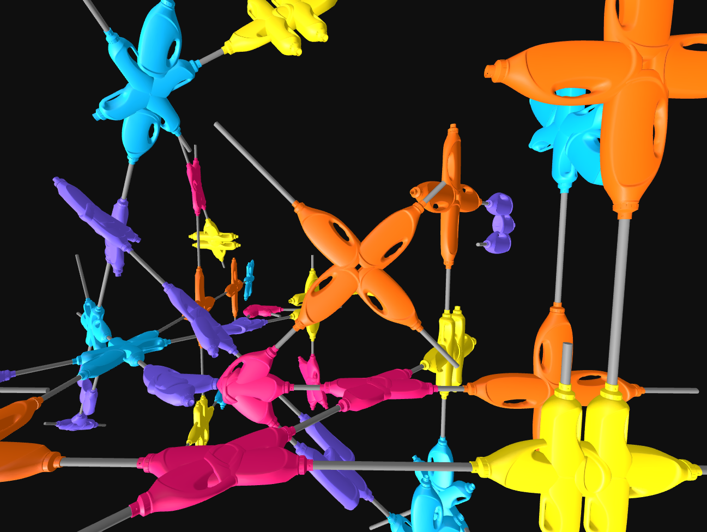

# Flex.Node v2

## Description

A construction kit built from recycled detergent bottles, custom-designed 3D-printed caps, and standard PVC pipes. Developed as part of the PEEK Inventorics Project (FWF AR 730-G)

## Information

| Field | Value |
|---|---|
| Slug | `flexnode-v2` |
| Author | [Naomi Neururer, Daniela Krönerth, Andrea Rossi, Lukas Allner](https://inventorics.com/) |
| License | CC-BY-SA-4.0 |
| Tags | `inventorics` `reuse` `upcycling` `plastic bottles` `flexnode` |
| Software | v0.7... |
| Units | Millimeters |
| Parts | 10 |
| Rules | 1392 |

## Files

- [aggregation.json](aggregation.json)
- [meta.json](meta.json)

---

This README was generated automatically from `meta.json`.
